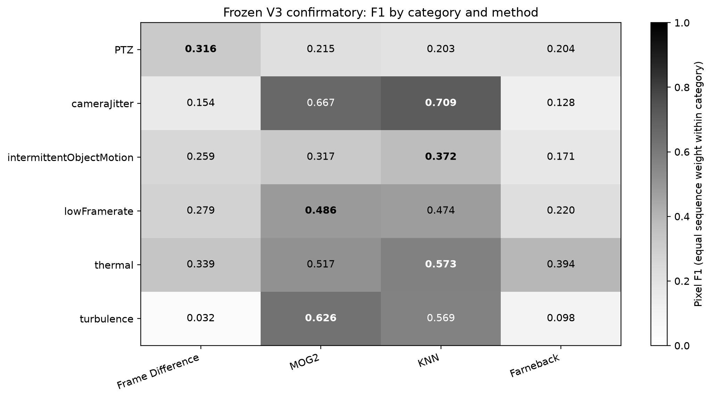
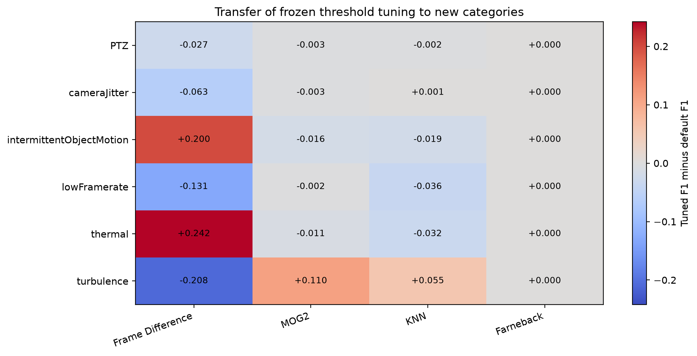
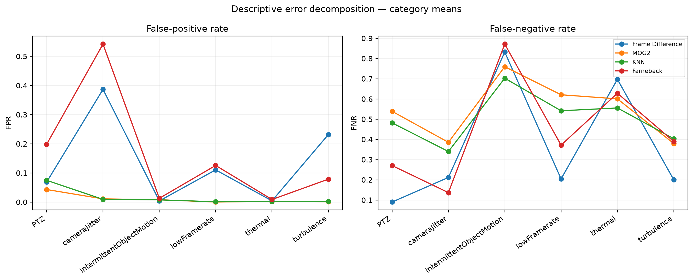

# Threshold Transfer and Category-Specific Performance in Classical Foreground Segmentation Across CDnet2014

**Manuscript class:** original empirical study / reproducible benchmarking (not a new algorithm proposal)  
**Authors / affiliations:** [Insert actual author identities and affiliations]  
**Corresponding author / ORCID:** [Complete before submission]  
**Submission status:** Evidence-grounded IJCCS manuscript draft. Main V3/V4 results are frozen; temporal and resolution follow-ups are explicitly post-hoc and exploratory. Author metadata and final Word pagination remain outstanding.  
**Last evidence audit:** 22 November 2026.

## Abstract

We compared frame differencing, MOG2, K-nearest-neighbor (KNN) background subtraction, and Farneback optical flow on CDnet2014 using fixed 320-pixel processing. Twenty-six sequences from five categories formed the development phase; 27 sequences from six disjoint categories were evaluated with frozen parameters. Equal-category-weighted pixel F1 scores were 0.230, 0.471, 0.483, and 0.203, respectively. Rankings varied by category: frame differencing led PTZ (F1 = 0.316), whereas MOG2 led turbulence (F1 = 0.626). Transfer was not uniformly beneficial; KNN scored 0.489 with its default threshold and 0.483 with the selected threshold. Exact category-level sign-flip tests found no Holm-adjusted support for either designated algorithm-superiority hypothesis (adjusted p = 0.062). Two directional preprocessing contrasts were supported (adjusted p = 0.031), conditional on the hypotheses having been specified before evaluation. Post-hoc temporal and resolution pilots on three selected sequences are descriptive only. Findings are limited by six category-level inferential units, fixed processing width, and unverified independent timestamp evidence for the directional protocol.

**Keywords:** foreground segmentation; background subtraction; CDnet2014; threshold transfer; domain robustness.

## Abstrak

Segmentasi latar depan konvensional tetap berguna pada analisis video dengan sumber daya terbatas, tetapi konfigurasi yang dipilih pada satu kelompok adegan belum tentu berpindah dengan baik ke kondisi pengawasan lain. Penelitian ini membandingkan frame differencing, adaptive Gaussian mixture modeling (MOG2), K-nearest-neighbor background subtraction (KNN), dan optical flow Farneback pada sebelas kategori CDnet2014 dengan lebar pemrosesan tetap. Sebanyak 26 sekuens dari lima kategori digunakan pada fase pengembangan, sedangkan 27 sekuens dari enam kategori terpisah dievaluasi menggunakan parameter beku. Rata-rata F1 berbobot kategori pada evaluasi adalah 0,230 untuk frame differencing, 0,471 untuk MOG2, 0,483 untuk KNN, dan 0,203 untuk Farneback. Rata-rata tersebut menyembunyikan variasi antar kategori: frame differencing memperoleh F1 tertinggi pada PTZ (0,316), sedangkan MOG2 tertinggi pada turbulence (0,626). Pemilihan parameter tidak selalu meningkatkan hasil transfer; F1 KNN dengan parameter bawaan adalah 0,489, dibandingkan 0,483 dengan parameter terpilih. Uji sign-flip eksak tingkat kategori tidak mendukung dua hipotesis keunggulan algoritma setelah koreksi Holm (p tersesuaikan 0,062). Analisis waktu dan resolusi tambahan dilakukan secara post-hoc pada tiga sekuens terpilih dan hanya bersifat eksploratif. Temuan dibatasi oleh enam unit kategori independen, pemrosesan utama 320 piksel, dan ketiadaan bukti waktu independen untuk protokol hipotesis satu arah.

**Kata kunci:** segmentasi latar depan; pengurangan latar; CDnet2014; transfer ambang; ketahanan domain.

## 1. Introduction

Foreground segmentation separates scene changes from relatively stable image content and serves as a building block in surveillance analytics, traffic monitoring, and resource-sensitive vision pipelines. Background-subtraction systems must distinguish true motion from shadows, camera movement, illumination variation, intermittent object motion, and dynamic textures. The CDnet2014 benchmark organizes such challenges into eleven categories, permitting evaluation beyond a single curated scene [1].

Methods based on frame differencing, pixel-level adaptive statistical backgrounds, and optical flow have different assumptions. Frame differencing reacts to local changes between adjacent frames; MOG2 and KNN maintain evolving background estimates; Farneback optical flow estimates dense inter-frame displacement [2–4]. Choosing one method on the basis of an aggregate F-measure may obscure reversals in ranking across conditions. More importantly, selecting thresholds on familiar sequences risks overestimating their usefulness on unfamiliar scene types.

Recent work on learned foreground segmentation demonstrates the breadth of this research area and the limitations of presenting classical baselines as contemporary state-of-the-art [5–7]. In contrast, the contribution claimed here is empirical and methodological: a documented comparison of four widely used classical methods, an explicit separation between development and later category-disjoint evaluation, paired category-level tests for specified contrasts, and transparent analysis of transfer failures. We do **not** claim a new segmentation algorithm or superior performance to modern supervised systems.

The research questions are: **RQ1:** How much do classical-method rankings vary between surveillance challenge categories? **RQ2:** Do thresholds selected from five development categories improve segmentation on six additional categories? **RQ3:** Under the recorded preprocessing protocol, what is the evidence for reducing frame-differencing false alarms using blur and increasing its F1 using morphology? **RQ4 (exploratory):** Which cases warrant subsequent time-resolved diagnosis of algorithm failures?

## 2. Related work

### 2.1. Classical foreground segmentation

Adaptive mixture models extend earlier statistical background subtraction by modeling the distribution of pixel values over time; Zivkovic's adaptive Gaussian formulation is an important reference for this family [2]. Pixel-level adaptive density estimation offers another route to learning background variation [3]. Dense Farneback flow is a polynomial-expansion-based motion estimator rather than a background model [4], making its responses and threshold semantics different from those of MOG2 and KNN. These distinctions motivate algorithm-aware reporting rather than an assumption that nominal threshold values are comparable across methods.

### 2.2. Challenging backgrounds and newer approaches

The original CDnet2014 study enlarged the benchmark to encompass eleven scene conditions [1]. More sophisticated unsupervised methods, including SuBSENSE [5], adapt local change sensitivity. Learned methods cover foreground segmentation [6], unseen-video background subtraction [8], spatiotemporal change detection [10], zero-shot background modeling [11], and sequential feature feedback [12]. BSUV-Net 2.0 extends unseen-video learning [9], while a recent comparative study surveys supervised architectures on CDnet2014 [7]. A direct modern-model run is not included: released training provenance and split protocols could not be aligned confidently with this study's category-disjoint holdout, so fair comparison and prior exposure control could not be demonstrated. We cite this literature as context and do not borrow its scores.

### 2.3. Specific gap

Research reports frequently prioritize mean segmentation accuracy. A separate practical question is whether a threshold chosen on one set of challenges remains beneficial across disjoint challenge groups. Rather than claiming that this question has never been studied, we contribute a transparent case study that documents both positive and negative transfer and distinguishes explicitly between confirmatory tests, exploratory secondary analyses, and post-hoc follow-up analyses requiring additional raw-video processing.

## 3. Dataset and methodology

### 3.1. Study phases and sampling

The available CDnet2014 data comprise 53 video sequences across eleven categories [1]. The recorded development phase used 26 sequences from **badWeather, baseline, dynamicBackground, nightVideos, and shadow**, with 10 sequences assigned to parameter tuning and 16 to development testing. Those development results were inspected during iteration and are therefore **not** a fresh independent confirmation. A later evaluation used all 27 available sequences in **PTZ, cameraJitter, intermittentObjectMotion, lowFramerate, thermal, and turbulence**, without parameter retuning. Sequence identities and allocation are provided in `working/results-v3-development/splits.csv` and `working/results-v3-confirmatory/splits.csv`.

The disjointness of sequence IDs is documented by archived manifests and cryptographic hashes. This establishes data separation in the supplied records, but cannot independently establish what researchers viewed before locking the hypothesis directions. Accordingly, any strict *preregistered* claim is conditional on external timestamp or version-control evidence that has not been supplied for independent verification.

### 3.2. Video preprocessing and frozen thresholds

All original primary experimental videos were resized to **320 pixels in width** while retaining their aspect ratio. The configured processing sequence applied Gaussian blur (5×5), the selected foreground detector, fixed foreground thresholding, ROI filtering, and binary morphology (opening with 3×3 and closing with 7×7 structuring elements). Background-subtraction shadow output values were converted to background before final evaluation. The study used parameter values saved after development: frame-differencing fixed threshold **5**, MOG2 variance threshold **25**, KNN squared-distance threshold **600**, and Farneback flow magnitude threshold **1.0**. Other algorithm defaults, histories and detector-specific details are archived in the original `run_info.json`; their numerical scales are not interchangeable.

The output foreground mask is used for **primary pixel-level scoring**. A contour-area minimum of 0.1% of the resized frame and a derived box representation apply to the **secondary frame/box analysis**, not to filtering every primary pixel. The 320-pixel measurements must not be described as native-resolution or official leaderboard outcomes.

### 3.3. Ground-truth definitions and metrics

Annotations label foreground as 255 and evaluable negatives as 0 or 50 (hard shadow). Labels 85 (outside-region) and 170 (unknown motion) are omitted; ROI.bmp is applied as an additional spatial inclusion mask when present. Nearest-neighbor resizing preserves discrete GT values. Counts (TP, FP, FN, TN) are accumulated over annotated pixels of each sequence. For each sequence,

\[
F_1=\frac{2TP}{2TP+FP+FN},\quad
FPR=\frac{FP}{FP+TN},\quad
FNR=\frac{FN}{FN+TP}.
\]

We average a metric over the sequences within each category and then equally over categories. In the six-category results, each challenge category therefore has weight 1/6, regardless of its number of frames or sequences. Reported intervals arise from the original hierarchical bootstrap of sequences within each category; they reflect variation under that resampling procedure and **do not** automatically capture uncertainty from re-sampling entirely new challenge categories. The labeling conventions are fully disclosed so differences from official CDnet submission evaluation can be audited.

### 3.4. Statistical testing and multiplicity

The inferential unit is the category (n = 6), not adjacent video frames. The original protocol used exact category-level paired sign-flip tests and adjusted p-values using Holm's step-down correction within two designated families: (H1) MOG2 F1 greater than frame-differencing F1 and (H2) KNN F1 greater than frame-differencing F1; and (H3) blur reduces the frame-differencing FPR and (H4) morphology increases its F1. The original test directions were **one-sided**. Two-sided p-values are retained as a sensitivity disclosure. The reader should not infer that the hypothesis directions were independently preregistered merely because a JSON protocol record is available; independent timestamp evidence is a separate requirement.

A broad collection of ablation contrasts and any rankings of problematic sequences were examined after the primary analysis and are identified as *exploratory*. No new directional hypothesis is promoted from those follow-ups to confirmatory status.

### 3.5. Computational evaluation

The original benchmark measured method processing calls in a serial per-detector trial and excluded image decoding, resizing, annotation I/O and application deployment overhead. Median observed throughputs for the six-category run were 2546 FPS (frame difference), 598 FPS (MOG2), 403 FPS (KNN), and 86 FPS (Farneback), under the specific recorded Windows, CPU, OpenCV and 320-pixel implementation. These numbers are **not** measurements of an end-to-end operational camera system or cross-paper hardware-normalized speed.

## 4. Results

### 4.1. Performance on six disjoint evaluation categories

**Table 1.** Equal-category-weighted results (pixel metrics) on 27 evaluation sequences. Confidence intervals are the original within-category hierarchical bootstrap intervals.

| Algorithm | Precision | Recall | F1 [95% CI] | PWC (%) |
|---|---:|---:|---:|---:|
| Frame Difference | 0.350 | 0.627 | 0.230 [0.172, 0.287] | 15.13 |
| MOG2 | 0.672 | 0.453 | 0.471 [0.405, 0.545] | 3.50 |
| KNN | 0.666 | 0.496 | **0.483 [0.404, 0.562]** | 3.79 |
| Farneback | 0.231 | 0.555 | 0.203 [0.151, 0.253] | 17.55 |

The largest descriptive mean F1 belongs to KNN, but this alone does not demonstrate its inferential superiority. Under the original designated one-sided tests, Holm-adjusted p-values were **0.062** for both MOG2 > frame difference and KNN > frame difference. Consequently, neither of these two algorithm-superiority hypotheses passes the declared 5% threshold after correction.

### 4.2. Category-specific reversals

**Table 2.** Pixel F1 by held-out challenge category.

| Category | n | Frame Diff. | MOG2 | KNN | Farneback |
|---|---:|---:|---:|---:|---:|
| PTZ | 4 | **0.316** | 0.215 | 0.203 | 0.204 |
| cameraJitter | 4 | 0.154 | 0.667 | **0.709** | 0.128 |
| intermittentObjectMotion | 6 | 0.259 | 0.317 | **0.372** | 0.171 |
| lowFramerate | 4 | 0.279 | **0.486** | 0.474 | 0.220 |
| thermal | 5 | 0.339 | 0.517 | **0.573** | 0.394 |
| turbulence | 4 | 0.032 | **0.626** | 0.569 | 0.098 |

The method ranking changes across categories. Frame differencing is strongest within PTZ, despite placing above only Farneback in the overall six-category mean. KNN leads on three categories and MOG2 on two. The post-hoc sequence-level inspection identifies `PTZ/intermittentPan` for later visual diagnosis; the observed difference between frame differencing and KNN is approximately +0.410 F1. This difference only prioritizes a case for scrutiny; it does not isolate its physical cause.

*Figure 1. Exploratory heatmap of pixel-level F1 by category, computed using previously recorded V3 results; it is not a separate confirmatory experiment.*

### 4.3. Transfer of development-selected thresholds

**Table 3.** Default and transferred tuned thresholds on the six-category evaluation set.

| Method | Parameter | Default | Development-selected | Default F1 | Selected F1 | Difference |
|---|---|---:|---:|---:|---:|---:|
| Frame Difference | fixed_thr | 25 | 5 | 0.228 | 0.230 | +0.002 |
| MOG2 | var_threshold | 16 | 25 | 0.459 | 0.471 | +0.012 |
| KNN | dist2_threshold | 400 | 600 | **0.489** | 0.483 | −0.006 |
| Farneback | flow_thr | 1 | 1 | 0.203 | 0.203 | 0.000 |

The near-zero or negative changes in several methods caution against assuming that development-selected parameters will systematically improve all later challenge groups. Since the default-versus-tuned analysis was not the primary preregistered test family, these differences are descriptive rather than new confirmatory findings.

*Figure 2. Descriptive selected-minus-default F1 contrasts across the six later categories.*

### 4.4. Designated preprocessing contrasts

**Table 4.** Primary recorded directional hypothesis decisions on the six-category evaluation set.

| Hypothesis | Reported effect | One-sided p | Holm-adjusted p | Interpretation |
|---|---:|---:|---:|---|
| H1 MOG2 F1 > Frame Diff. | +0.241 F1 | 0.047 | 0.062 | Not significant |
| H2 KNN F1 > Frame Diff. | +0.253 F1 | 0.031 | 0.062 | Not significant |
| H3 Blur lowers Frame Diff. FPR | −0.028 FPR | 0.016 | **0.031** | Direction supported, conditional |
| H4 Morphology raises Frame Diff. F1 | +0.041 F1 | 0.016 | **0.031** | Direction supported, conditional |

H3 and H4 satisfy the declared one-sided multiple-comparison threshold. This interpretation **depends** on the directional formulation having been established before the six-category data were viewed. The two-sided significance conclusion is less favorable, and broad exploratory factorial contrasts have distinct multiplicity corrections. It would be incorrect to label every preprocessing effect as statistically significant or to reinterpret the confirmatory family after observing outcomes.

### 4.5. Error profiles and efficiency

The error-profile tables and False Positive Rate / False Negative Rate figure in the supplemental package help explain aggregate score trade-offs, without attributing errors to an unmeasured motion mechanism. Frame-differencing's recall (0.627) exceeds that of MOG2 (0.453) and KNN (0.496), but its precision (0.350) is substantially lower. This asymmetry is consistent with additional false alarms at this configuration. Secondary frame-based MCC has undefined cases where the necessary denominator vanishes; the number of valid observations must therefore be reported for those comparisons rather than silently assumed equal to 27.

*Figure 3. Descriptive per-category error-rate profiles from V4; hypothesis tests remain those of the frozen V3 phase.*

### 4.6. Post-hoc temporal and resolution pilots

Three sequences were selected after inspection of the primary outputs: `PTZ/intermittentPan`, `turbulence/turbulence0`, and `cameraJitter/badminton`. The temporal pilot covered 6,653 annotated frames.

**Table 5.** Pooled pixel F1 in the post-hoc temporal pilot.

| Sequence | Frames | Frame diff. | MOG2 | KNN | Farneback |
|---|---:|---:|---:|---:|---:|
| PTZ/intermittentPan | 2,301 | 0.4643 | 0.0620 | 0.0544 | 0.3315 |
| turbulence/turbulence0 | 4,001 | 0.0126 | 0.4417 | 0.2805 | 0.0287 |
| cameraJitter/badminton | 351 | 0.1799 | 0.8127 | 0.8578 | 0.0998 |

These are sequence-specific pooled pixel scores; frames are not independent replicates, and the selected sequences are not a representative sample. The pilot is consistent with context dependence but cannot identify a mechanism.

The companion resolution run evaluates the same cases at 320 pixels, 640 pixels, and native width, with the original frozen parameters.

**Table 6.** Pooled pixel F1 under the post-hoc resolution sensitivity run.

| Sequence | Requested | Actual width | Frame diff. | MOG2 | KNN | Farneback |
|---|---:|---:|---:|---:|---:|---:|
| PTZ/intermittentPan | 320 | 320 | 0.4643 | 0.0620 | 0.0544 | 0.3315 |
| PTZ/intermittentPan | 640 | 560 | 0.2688 | 0.0832 | 0.0650 | 0.2462 |
| PTZ/intermittentPan | native | 560 | 0.2688 | 0.0832 | 0.0650 | 0.2462 |
| turbulence/turbulence0 | 320 | 320 | 0.0126 | 0.4417 | 0.2805 | 0.0287 |
| turbulence/turbulence0 | 640 | 640 | 0.0063 | 0.2935 | 0.2377 | 0.0070 |
| turbulence/turbulence0 | native | 720 | 0.0057 | 0.2746 | 0.2329 | 0.0061 |
| cameraJitter/badminton | 320 | 320 | 0.1799 | 0.8127 | 0.8578 | 0.0998 |
| cameraJitter/badminton | 640 | 640 | 0.1371 | 0.7997 | 0.8541 | 0.1116 |
| cameraJitter/badminton | native | 720 | 0.1312 | 0.7931 | 0.8504 | 0.1117 |

The requested 640-pixel width was capped to 560 px for PTZ; consequently its 640-pixel and native rows are identical. The run is a sensitivity analysis, not a resolution-optimized benchmark. See `working/final-temporal/` and `working/final-resolution/` for per-frame records, summaries, figures, and manifests. No inferential test is applied to these post-hoc pilots.

## 5. Discussion

### 5.1. Aggregate rankings are not general selection rules

The aggregate KNN F1 lead of roughly 0.012 over MOG2 masks the different relative rankings in PTZ, lowFramerate and turbulence. This illustrates why a single average cannot identify a universally best detector. The apparent advantages of more adaptive models depend on scene characteristics and the chosen metric, and should be examined using category-specific profiles as well as primary inferential comparisons.

### 5.2. Threshold transfer is not uniformly beneficial

MOG2's selected variance threshold yielded a small descriptive improvement on the later categories, while KNN's transferred threshold did not exceed its default. This result is compatible with distribution dependence and does not, by itself, establish the mechanism of overfitting. Development and later evaluation groups differ by category by design, so a causal assertion about generalization decay would require additional matching or randomized transfer experiments.

### 5.3. Candidate failure mechanism: PTZ

A plausible hypothesis is that camera pan alters successive image differences and the adaptation dynamics of background models. A post-hoc temporal analysis was run on three sequences selected from earlier failure inspection (6,653 annotated frames total). It reconstructs per-frame TP/FP/FN/TN, produces aligned prediction overlays, and computes a global phase-correlation displacement proxy. The proxy can be distorted by moving foreground objects and texture; any association is diagnostic and non-causal. These selected-sequence results do not estimate a population effect and are not inferential evidence.

### 5.4. Generalizability, contemporary baselines and resolution

The fixed 320-pixel processing width is a controlled computational choice but affects apparent object size and optical-flow magnitude. A supplementary post-hoc fixed-parameter resolution sensitivity run covers 320 px, 640 px when available, and native width on the same three selected sequences. It is descriptive only: parameters are frozen without scale-specific retuning, the pilot sequences were selected after the primary analysis, and the result does not replace the 320-pixel primary evaluation. No modern model was run because split and training-data provenance could not be aligned confidently with the category-disjoint holdout. The external-mask adapter remains a future interface and supplies no evaluated modern-model scores.

## 6. Threats to validity

**Internal validity.** Historical sequence manifests document split identity, but no independent timestamp certificate is included for the directional hypothesis protocol. Past inspection of development data is acknowledged. Exploratory case selection cannot support a new confirmatory claim.

**Statistical validity.** The primary independent units are six categories. Exact sign-flip inference is discrete and has limited power; a one-sided direction requires a defensible prior rationale. Bootstrap intervals resampling sequences within fixed categories answer a different uncertainty question than resampling new categories. Pooled frame observations must not be used as artificially independent samples.

**Measurement validity.** The 320-pixel resizing, shadow treatment, ROI masks, background warm-up, and processing-only speed definition restrict direct comparison to reported CDnet leaderboard or other studies. Primary pixel scores are unaffected by the contour-area filtering used for secondary box scores.

**External validity.** Four classical methods do not represent the state of the art. Observations on CDnet2014, even across eleven categories and two phases, should not be extended to unrelated application domains without new data. A single CPU workstation does not establish cross-hardware real-time suitability.

## 7. Conclusions

This study documents heterogeneous category-level performance in four classical foreground segmentation algorithms and shows that selected thresholds cannot be assumed to transfer beneficially across video conditions. On the six-category later evaluation set, KNN had the highest descriptive F1 (0.483), yet both designated algorithm-superiority hypotheses failed the Holm-adjusted significance criterion. Recorded directional preprocessing comparisons favored Gaussian blur for false-positive reduction and morphology for pixel F1 improvement, conditional on independently defensible prior hypothesis directions. Evidence-based interpretation requires phase separation, explicit GT conventions, category-aware inference, and transparent acknowledgement of untested mechanisms. Post-hoc temporal and resolution pilots add descriptive diagnostics but do not establish causal explanations or replace broader evaluation.

## Data, code, and reproducibility statement

Source data are from the public CDnet2014 benchmark [1] and must be obtained under the dataset provider's terms; raw videos are **not bundled**. The archive includes frozen parameters, development and evaluation result tables, original V3/V4 scripts and notebooks, SHA-256 input manifest, analysis reports, and post-hoc code and outputs. The source dataset was present locally for the follow-up audit and pilot runs. The recorded environment is Windows 11, Python 3.15.2, OpenCV 5.1.0, NumPy 2.5.5, and pandas 3.1.1. A recommended Python 3.11 environment is documented separately. The audit verifies frozen-table arithmetic and recorded source-file hashes; local dataset availability does not constitute an independent third-party reproduction.

## Ethical, funding, conflict-of-interest, and author declarations

**Ethics:** Public video benchmark; confirm the dataset license and institutional ethics requirements before submission.  
**Funding:** [Insert actual funding or explicitly state none.]  
**Competing interests:** [Author-confirmed declaration required.]  
**Author contributions:** [Complete using actual contributor roles.]  
**Data availability:** CDnet2014 (external benchmark); derived results and scripts in accompanying archive, subject to appropriate sharing permissions.

## References

[1] Y. Wang, P.-M. Jodoin, F. Porikli, J. Konrad, Y. Benezeth, and P. Ishwar, “CDnet 2014: An expanded change detection benchmark dataset,” in *Proc. IEEE Conf. Comput. Vis. Pattern Recognit. Workshops*, 2014. [Online]. Available: https://openaccess.thecvf.com/content_cvpr_workshops_2014/W12/html/Wang_CDnet_2014_An_2014_CVPR_paper.html

[2] Z. Zivkovic, “Improved adaptive Gaussian mixture model for background subtraction,” in *Proc. Int. Conf. Pattern Recognit.*, 2004. [Online]. Available: https://doi.org/10.1109/ICPR.2004.1333992

[3] Z. Zivkovic and F. van der Heijden, “Efficient adaptive density estimation per image pixel for the task of background subtraction,” *Pattern Recognit. Lett.*, 2006. [Online]. Available: https://www.sciencedirect.com/science/article/pii/S0167865505003521

[4] G. Farnebäck, “Two-frame motion estimation based on polynomial expansion,” in *Proc. Scandinavian Conf. Image Anal.*, 2003. [Online]. Available: https://doi.org/10.1007/3-540-45103-X_50

[5] P.-L. St-Charles, G.-A. Bilodeau, and R. Bergevin, “SuBSENSE: A universal change detection method with local adaptive sensitivity,” *IEEE Trans. Image Process.*, 2015. [Online]. Available: https://doi.org/10.1109/TIP.2014.2378053

[6] L. A. Lim and H. Y. Keles, “Learning multi-scale features for foreground segmentation,” *Pattern Anal. Appl.*, 2019. [Online]. Available: https://doi.org/10.1007/s10044-019-00845-9

[7] O. Boufares, W. Saadaoui, and M. Boussif, “Comparative study of supervised deep learning architectures for background subtraction and motion segmentation on CDnet2014,” *Signals*, vol. 7, no. 1, Art. no. 14, 2026. [Online]. Available: https://doi.org/10.3390/signals7010014

[8] M. O. Tezcan, P. Ishwar, and J. Konrad, “BSUV-Net: A fully-convolutional neural network for background subtraction of unseen videos,” in *Proc. IEEE/CVF Winter Conf. Appl. Comput. Vis.*, 2020, pp. 2763–2772. [Online]. Available: https://doi.org/10.1109/WACV45572.2020.9093464

[9] M. O. Tezcan, P. Ishwar, and J. Konrad, “BSUV-Net 2.0: Detection of moving objects in video,” *IEEE Access*, vol. 9, pp. 53849–53860, 2021. [Online]. Available: https://doi.org/10.1109/ACCESS.2021.3071163

[10] M. Mandal *et al*., “3DCD: Scene independent end-to-end spatiotemporal feature learning framework for change detection in unseen videos,” *IEEE Trans. Image Process.*, vol. 30, pp. 546–558, 2021. [Online]. Available: https://doi.org/10.1109/TIP.2020.3037472

[11] J. An, Y. Zhang, B. Li, Y. Hu, W. Liu, and Y. Guo, “ZBS: Zero-shot background subtraction via instance-level background modeling and foreground selection,” in *Proc. IEEE/CVF Conf. Comput. Vis. Pattern Recognit.*, 2023, pp. 6355–6364. [Online]. Available: https://openaccess.thecvf.com/content/CVPR2023/html/An_ZBS_Zero-Shot_Background_Subtraction_via_Instance-Level_Background_Modeling_and_Foreground_CVPR_2023_paper.html

[12] Y.-S. Huang *et al*., “SeqFeedNet: Sequential feature feedback network for background subtraction,” in *Proc. IEEE/CVF Winter Conf. Appl. Comput. Vis.*, 2026, pp. 8199–8208. [Online]. Available: https://openaccess.thecvf.com/content/WACV2026/papers/Huang_SeqFeedNet_Sequential_Feature_Feedback_Network_for_Background_Subtraction_WACV_2026_paper.pdf

---

**Editorial gate, not part of the manuscript when submitted:** IJCCS is the selected target. Complete actual author identities, affiliation, ORCID, funding and declarations; independently substantiate any preregistration timestamp claim or retain the stated caveat; inspect pagination in Word against the 10–12-page guide; and obtain author approval. No guarantee of peer-review acceptance is implied.

